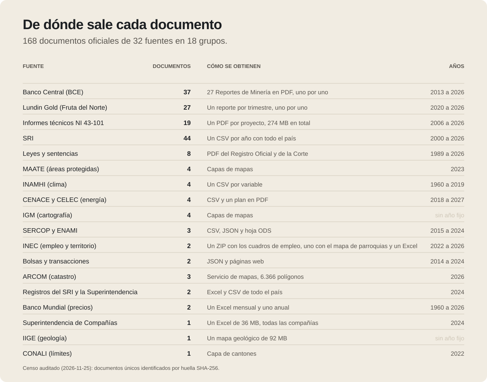

# De dónde sale cada documento

[Volver al inicio](README.md)

<picture>
  <source media="(prefers-color-scheme: dark)" srcset="docs/img/fuentes-oscuro.svg">
  
</picture>

La misma tabla en texto, para buscar y copiar

| Fuente | Documentos | Cómo se obtienen | Años |
|---|---:|---|---|
| Banco Central (BCE) | 37 | 27 Reportes de Minería en PDF, uno por uno | 2013 a 2026 |
| Lundin Gold (Fruta del Norte) | 27 | Un reporte por trimestre, uno por uno | 2020 a 2026 |
| Informes técnicos NI 43-101 | 19 | Un PDF por proyecto, 274 MB en total | 2006 a 2026 |
| SRI | 44 | Un CSV por año con todo el país | 2000 a 2026 |
| Leyes y sentencias | 8 | PDF del Registro Oficial y de la Corte | 1989 a 2026 |
| MAATE (áreas protegidas) | 4 | Capas de mapas | 2023 |
| INAMHI (clima) | 4 | Un CSV por variable | 1960 a 2019 |
| CENACE y CELEC (energía) | 4 | CSV y un plan en PDF | 2018 a 2027 |
| IGM (cartografía) | 4 | Capas de mapas | — |
| SERCOP y ENAMI | 3 | CSV, JSON y hoja ODS | 2015 a 2024 |
| INEC (empleo y territorio) | 2 | Un ZIP con los cuadros de empleo, uno con el mapa de parroquias y un Excel | 2022 a 2026 |
| Bolsas y transacciones | 2 | JSON y páginas web | 2014 a 2024 |
| ARCOM (catastro) | 3 | Servicio de mapas, 6.366 polígonos | 2026 |
| Registros del SRI y la Superintendencia | 2 | Excel y CSV de todo el país | 2024 |
| Banco Mundial (precios) | 2 | Un Excel mensual y uno anual | 1960 a 2026 |
| Superintendencia de Compañías | 1 | Un Excel de 36 MB, todas las compañías | 2024 |
| IIGE (geología) | 1 | Un mapa geológico de 92 MB | — |
| CONALI (límites) | 1 | Capa de cantones | 2022 |

