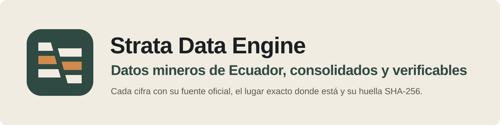
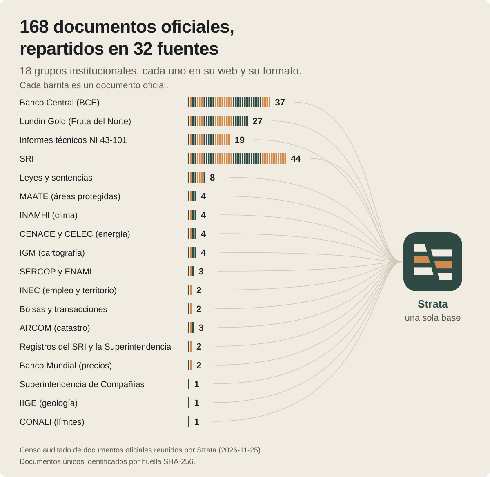
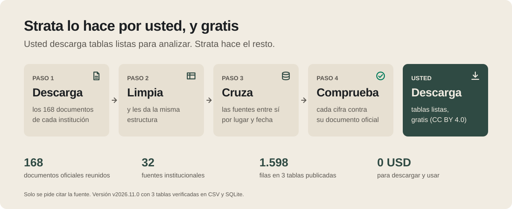
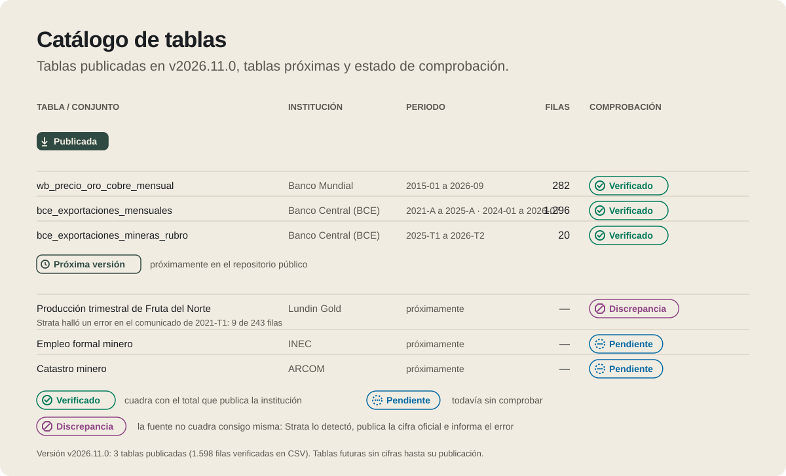
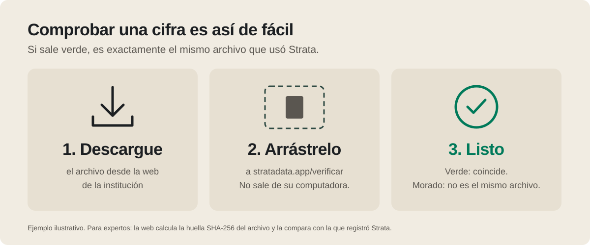
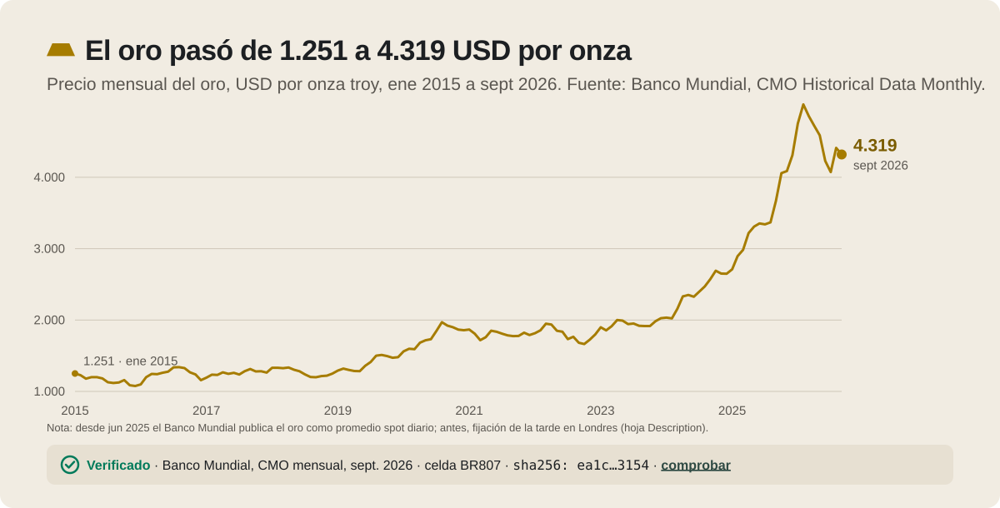
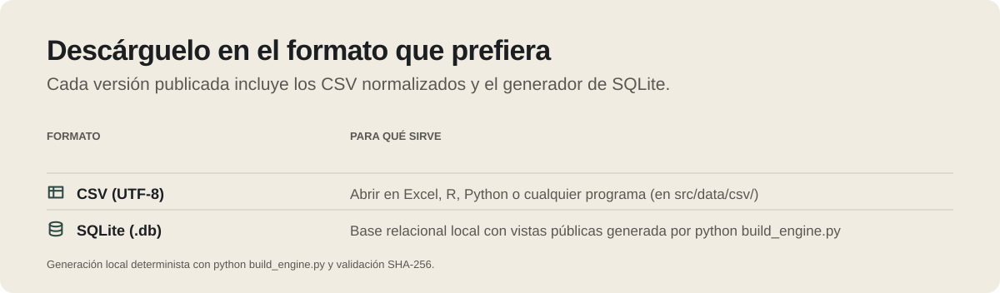

<picture>
  <source media="(prefers-color-scheme: dark)" srcset="docs/img/banner-oscuro.svg">
  
</picture>

<p>
  
  
  
  
  <a href="https://www.instagram.com/stratadataec/"></a>
</p>

Strata Data Engine reúne y verifica los datos públicos de la minería en Ecuador: precios internacionales de referencia, exportaciones y series oficiales documentadas. Hoy esas cifras están repartidas en cientos de documentos de instituciones distintas, cada uno en su web y en su formato. Aquí están limpias, con la misma estructura y listas para cruzar.

Lo que distingue a Strata es que cada cifra se puede comprobar. Cada dato indica de qué archivo oficial sale, en qué página, cuadro o celda está, y la huella de ese archivo. No hace falta confiar en Strata: basta con descargar el archivo de la institución y comprobarlo.

## El problema

<picture>
  <source media="(prefers-color-scheme: dark)" srcset="docs/img/problema-oscuro.svg">
  
</picture>

**[Ver de dónde sale cada documento: las 32 fuentes, cómo se obtienen y qué años cubren](FUENTES.md)**

## La solución

<picture>
  <source media="(prefers-color-scheme: dark)" srcset="docs/img/solucion-oscuro.svg">
  
</picture>

## Catálogo de tablas

<picture>
  <source media="(prefers-color-scheme: dark)" srcset="docs/img/catalogo-oscuro.svg">
  
</picture>

<details>
<summary>El catálogo en texto, para buscar y copiar</summary>

| Tabla / Conjunto | Institución | Periodo | Filas | Comprobación | Publicación |
|---|---|---|---:|---|---|
| `wb_precio_oro_cobre_mensual` | Banco Mundial | 2015-01 a 2026-09 | 282 | Verificado | Publicada |
| `bce_exportaciones_mensuales` | Banco Central (BCE) | 2021-A a 2025-A · 2024-01 a 2026-07 | 1.296 | Verificado | Publicada |
| `bce_exportaciones_mineras_rubro` | Banco Central (BCE) | 2025-T1 a 2026-T2 | 20 | Verificado | Publicada |
| `Producción trimestral de Fruta del Norte` | Lundin Gold | próximamente | — | Discrepancia (Strata halló un error en el comunicado de 2021-T1: 9 de 243 filas) | Próximamente |
| `Empleo formal minero` | INEC | próximamente | — | Pendiente | Próximamente |
| `Catastro minero` | ARCOM | próximamente | — | Pendiente | Próximamente |

</details>

### Un error hallado en la fuente

En el comunicado del primer trimestre de 2021 de Lundin Gold (Fruta del Norte), el desglose suma `70.642 + 33.675 = 104.317` onzas frente a `104.137` publicadas; el total del año sí cuadra con el acumulado anual.

## Cómo se comprueba

<picture>
  <source media="(prefers-color-scheme: dark)" srcset="docs/img/verificar-oscuro.svg">
  
</picture>

<details>
<summary>Para expertos: comprobarlo sin la web</summary>

Cada archivo oficial tiene una huella SHA-256 registrada en `manifest.json` y cada CSV publicado en `src/data/checksums_sha256.txt`. Para calcularla:

- Linux o macOS: `sha256sum CMO-Historical-Data-Monthly.xlsx`
- Windows: `certutil -hashfile CMO-Historical-Data-Monthly.xlsx SHA256`
- Verificador incluido: `python build_engine.py --verify-only`

Ejemplo real: el Excel mensual del Banco Mundial da `ea1c350827878ea3bbe30e3cda16a13fd3bd5b409b8458940dc94a36b5a33154`; el precio del oro de septiembre de 2026 está en la hoja `Monthly Prices`, celda `BR807`.

Un PDF o un Excel que no cambia se comprueba por su huella. Una fuente dinámica (una API o un archivo que se genera al descargarlo) puede dar otra huella con los mismos datos; esa se comprueba por el valor de su celda.
</details>

## Ejemplo: el precio del oro

<picture>
  <source media="(prefers-color-scheme: dark)" srcset="docs/img/grafica-oro-oscuro.svg">
  
</picture>

## Cómo usarlo

<picture>
  <source media="(prefers-color-scheme: dark)" srcset="docs/img/formatos-oscuro.svg">
  
</picture>

Clone el repositorio y construya la base local SQLite validando las huellas SHA-256:

```bash
git clone https://github.com/strata-data/datos.git
cd datos
python build_engine.py
```

Esto genera `strata_public.db` con las 3 tablas (`wb_precio_oro_cobre_mensual`, `bce_exportaciones_mensuales` y `bce_exportaciones_mineras_rubro`) y las vistas analíticas públicas. Opciones útiles:

```bash
python build_engine.py --verify-only      # Solo valida checksums SHA-256
python build_engine.py --target postgres  # Carga en PostgreSQL local o remoto
python build_engine.py --db-path mi_bd.db # Ruta personalizada para SQLite
```

- **Comprobar un archivo oficial:** en [https://stratadata.app/verificar](https://stratadata.app/verificar).

## Versiones

La versión publicada actual es `v2026.11.0`, con las 3 tablas verificadas en `src/data/csv/` y sus huellas en `manifest.json` y `src/data/checksums_sha256.txt`. El historial de cambios está en `CHANGELOG.md`.

## Reportar un error en los datos

¿Encontró una cifra que no coincide con su fuente? Abra un [*issue*](https://github.com/strata-data/datos/issues) con:

1. La tabla y la fila.
2. El valor que muestra Strata y el que muestra la fuente.
3. El enlace al documento oficial y la página, el cuadro o la celda.

Se revisa contra el documento oficial. Si corresponde, se corrige en la siguiente versión y se anota en `CHANGELOG.md`.

## Comunidad

Manténgase al tanto de cada versión nueva en [Instagram](https://www.instagram.com/stratadataec/), [YouTube](https://www.youtube.com/@stratadataec) y [LinkedIn](https://www.linkedin.com/company/stratadata).

## Cómo citar

> Fuente de datos: Strata Data Engine (https://github.com/strata-data/datos), CC BY 4.0. Datos originales: [institución emisora, por ejemplo BCE o Banco Mundial].

## Autores y colaboradores

- **Autor:** Strata Data EC.
- **Colaboradores:** quienes reportan errores, proponen fuentes o envían mejoras en el repositorio.

## Licencias

- **Datos, manifiesto y lista de fuentes:** CC BY 4.0. Ver `DATA_LICENSE.md`.
- **Código y scripts de carga:** MIT. Ver `LICENSE`.
- **Datos de las instituciones públicas:** conservan los términos de su institución emisora. CC BY 4.0 cubre lo que aporta Strata: la selección, la limpieza y la estructura.

## Enlaces

[stratadata.app](https://stratadata.app) · [Instagram](https://www.instagram.com/stratadataec/) · [YouTube](https://www.youtube.com/@stratadataec) · [LinkedIn](https://www.linkedin.com/company/stratadata) · [Issues](https://github.com/strata-data/datos/issues)
